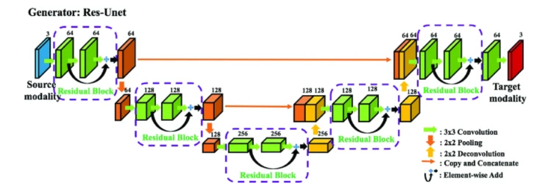
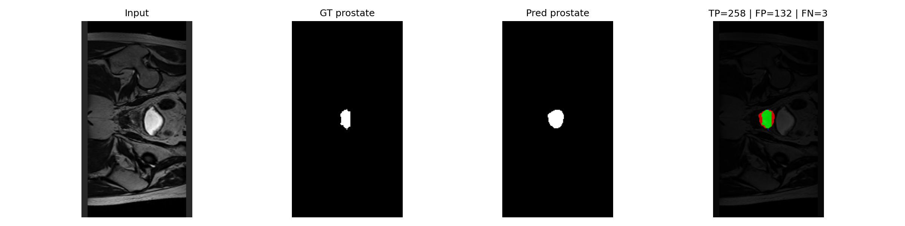
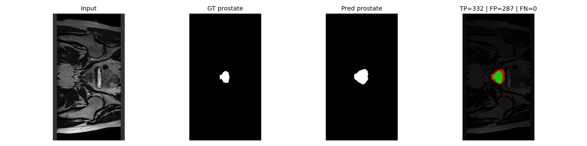
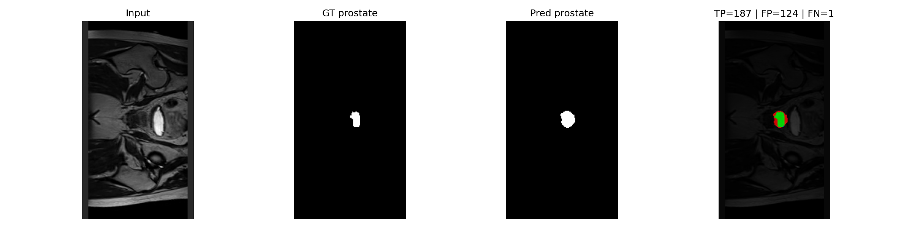
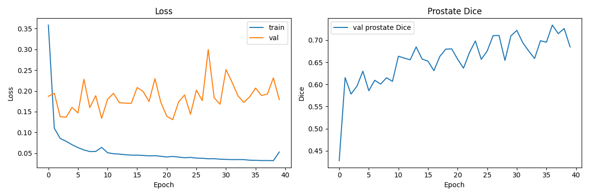
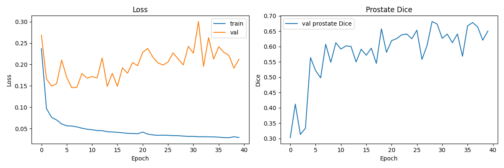
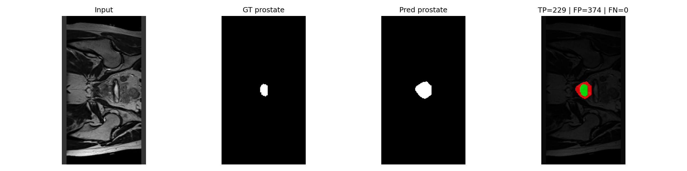
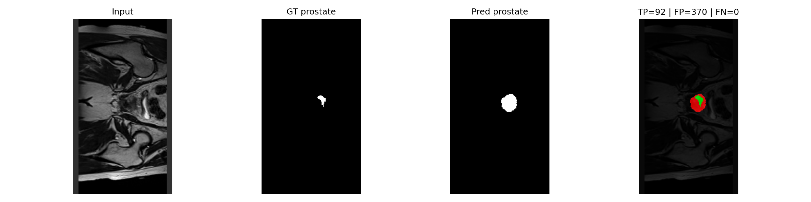
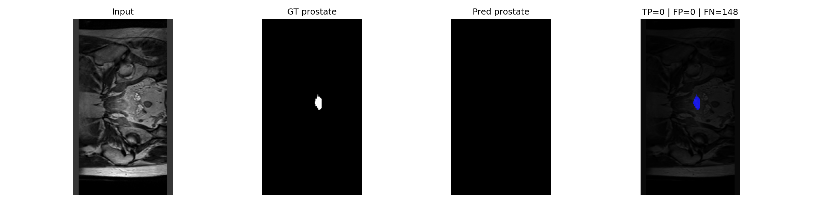

# Improved 2D U-Net for Prostate Segmentation in Radiotherapy Planning
**Student Name:** Hoong Lee Gan  
**Student ID:** 49128499  
**Course:** COMP3710  
**Target Domain:** Prostate Radiotherapy Planning  
**Assigned Difficulty:** Normal Difficulty - Improved 2D U-Net  

External beam radiotherapy for prostate cancer requires millimetre-level delineation of the prostate target volume while sparing adjacent organs at risk. Manual contouring is time-consuming, motivating an automated annotation assistant that proposes contours for a specialist to review and adjust. The main engineering challenge is boundary fidelity. Metrics such as Sørensen–Dice coefficient can appear acceptable while masking hazardous local failures. Leakage across millimetre-thin interface into surrounding tissues which causes radiation proctitis or cystitis, while under-contouring risks tumour recurrence. This project implements and evaluates an Improved 2D U-Net to determine whether residual connections improve boundary adherence on HipMRI prostate slices without meaningful increase in computational cost.

The network follows a standard U-Net topology where an encoder extracts hierachical features through 4 downsampling stages, a bottleneck captures global context, and a decoder restores full resolution through 4 upsampling stages, with skip connections concatenating encoder feature maps into the decoder to preserve fine spatial detail. The Improved 2D U-Net introduces a residual modification which replaces each two-convolution block with a residual block which are 2 3x3 conv-BatchNorm-ReLU layers whose output is added to a shortcut connection of the input, followed by ReLU. This gives gradients a direct path through the network which improves the optimisation of deep layers, allowing finer boundary refinement. The input is a 256x128 MRI slice and the output is a six-channel logit map, trained with weighted cross-entropy loss to counter severe imbalance in the dataset.



_Improved 2D U-Net Figure (From https://link.springer.com/chapter/10.1007/978-3-030-00889-5_18#Fig3)_

## Feasibility Review

### 1. User Need, Scope & Acceptance Criteria: 

**Intended User:** An imaging specialist reviewing automated prostate contours in a radiotherapy planning pipeline

**Prototype Purpose:** Determine whether a 2D Improved U-Net can draft the prostate clinical target volume with sufficient boundary accuracy to reduce manual contouring time, without leakage into adjacent organs at risk.

**Acceptance Criteria:**

| # | Criterion | Target |
| :-: | - | :-: |
| AC1 | Prostate Dice on hold-out test set | ≥ 0.75 |
| AC2 | Prostate Precision and Recall | ≥ 0.85, ≥ 0.85 |
| AC3 | Boundary Precision: 95% Hausdorff Distance (HD95) for prostate | ≤ 5mm |
| AC4 | Peak VRAM | ≤ 2 GB |

### 2. Model Choice & Course Concepts:

**Dataset Configuration:** HipMRI 2D slices  
**Chosen Model:** 2D Improved U-Net (Normal Difficulty) - Target Dice ≥ 0.75 on prostate label  
**Baseline Model:** Basic 2D U-Net 
 
- U-Net’s encoder-decoder with skip connections preserves fine spatial detail for precise localisation. 
- Improved U-Net adds residual blocks and deeper feature extraction supporting better boundary adherence. 
- U-Net architectures achieve clinically acceptable Dice for prostate target volumes. 
- The Prostate apex boundaries are inherently blurred which motivates architectural refinement.

### 3. Preliminary Feasibility Evidence:

**Data Audit:** Loaded 20 HipMRI 2D training slices  
**X shape:** (20, 256, 128)  
**y shape:** (20, 256, 128, 6)  
**Smoke Test:** Trained basic 2D U-Net on 20 slices for 10 epochs on cuda with training loss decreasing from 1.94 to 0.84  
**Peak VRAM:** 0.45 GB at batch size 4, 256x128 input  
**Per Epoch Time:** 0.22 seconds ~
### 4. Risks, Budget & Fallback: 

| Risk | Likelihood | Mitigation |
| - | - | - |
| Base/Apex under-countouring persists despite Dice ≥ 0.75 | Medium | Report HD95 |
| Rectal/bladder boundary leakage | Medium | Multi-class training preserves OAR context |

**Computing budget:** Peak VRAM ≤ 2 GB  
**Next planned experiment:** Train full basic 2D U-Net baseline on complete HipMRI training split  
**Workable fallback:** If improved U-Net training is unstable, retain basic 2D U-Net as primary model and reframe project accordingly  

## Dependencies and Reproducibility

| Dependency | Version |
| ---: | --- |
| torch | 2.14.1+cu126 |
| torchvision | 0.29.1+cu126 |
| tqdm | 4.70.1 |
| scipy | 1.17.1 |
| numpy | 2.3.3 |
| nibabel | 5.4.2 |
| matplotlib | 3.10.7 |

### Reproducibility of Results

A random seed of 42 was set at the beginning of train.py for reproducibility.

```
python train.py --model unet2d  
python train.py --model improvedunet2d
python predict.py --model unet2d
python predict.py --model improvedunet2d
```

Usage for training and loading models for predictions.

### File Structure

```text
├── data/keras_slices_data/                 # data files
│               └── keras_slices_seg_test   
│               └── keras_slices_seg_train
│               └── keras_slices_seg_validate
│               └── keras_slices_test
│               └── keras_slices_train
│               └── keras_slices_validate
├──images/                      # Plots and figures
├──models/                      # Saved models
├──audit.py                     # Dataset audit
├──dataset.py                   # HipMRI slice loading and dataloader builders
├──modules.py                   # Houses the model framework
├──predict.py                   # Load train models and perform inference
├──smoke.py                     # Smoke test for feasibility review
├──train.py                     # Model Training
├──README.md                    # Documentation
```

The file structure above was used during training and testing of models. As stated in the project brief, the data and models folders have not been commited to the github repo.

## Example inputs/outputs + Visual Plots





_Input, GT, Pred, Error Overlay Figures_

The above figures show the inputs, ground truth for prostate, predicted prostate, and error overlay for three separate test slices, loaded using the Improved 2D U-Net model. Green indicates the ground truth, red indicates the predicted prostate, and blue indicates prostate tissue that was missed by the model.


## Data pre-processing

| Class | Percentage of total pixels / % | Presence in all slices |
| :---: | :---: | :---: |
| 0 | 23.14 | 11460/11460 |
| 1 | 62.68 | 11460/11460 |
| 2 | 11.64 | 11406/11460 |
| 3 | 1.81 | 8300/11460 |
| 4 | 0.33 | 4056/11460 |
| 5 | 0.40 | 4152/11460 |

_Class distribution across 11460 training slices_

| Class | Percentage of total pixels / % | Presence in all slices |
| :---: | :---: | :---: |
| 0 | 23.34 | 660/660 |
| 1 | 62.52 | 660/660 |
| 2 | 11.65 | 660/660 |
| 3 | 1.55 | 463/660 |
| 4 | 0.50 | 255/660 |
| 5 | 0.44 | 254/660 |

_Class distribution across  660 validation slices_ 

The provided HipMRI slice dataset was pre-split into 11460 slices for training, 660 for validation, and 540 for testing. With a split of 91%/5%/4%, I felt resplitting was unnecessary. All HipMRI slices were loaded from the Nifti format with the third spatial dimension collapsed whenever it was present. I applied three pre-processing steps which include intensity normalisation, resizing to a fixed size, and one hot mask encoding. Intensity normalisation removes and inter-scan variation while preserving intra-slice contrast between the prostate, bladder, and other surrounding tissues. The resizing was done as the slices in the dataset were not uniformly sized which caused errors during the data audit. Finally, one hot mask encoding was done as without a fixed list of class indicies, the slices would produce inconsistent channel counts and fail to batch.

For the training set, a transformation was applied to each slice at random, either flipping it horizontally or adding random rotations of 10 degrees. A horizontal flip was choson as it was anatomically safe for pelvic anatomy as pelvic anatomy has left-right symmetry. A slight rotation of 10 degrees was randomly added to simulate the patient's positioning potentially having variance. No transforms were added to the validation and test data.

From the class distribution tables above, a severe class imbalance can be seen with class 5 (which is the Prostate label) only occupying 0.40% of the test dataset and only appearing in 4152 out of 11460 slices. To combat this, I used weighted cross-entropy loss with the following class weights to boost the prostate's class ([0.1, 0.1, 0.5, 2.0, 5.0, 10.0]). As for the patients, their IDs were extracted from the filenames and intersected across the 3 sets of data, showing no leakage between the sets. The training set had 31 patients while the validation and test sets had 4 and 3 patients each.

## Open Research Dilemma:

### Quantitative Benchmarking




_Train Loss and Prostate Dice curves, Baseline (above) and Improved (below)_

The above figures show the training loss, validation loss, and validation prostate dice over 40 epochs for the model training of the Baseline model and the Improved model. Both figures show the model overfitting to the training data which can be seen by the large disparities between validation loss and training loss.

| Class | Baseline Dice | Improved U-Net Dice | Δ Dice | Basic U-Net IoU | Improved U-Net IoU | Δ IoU |
| ---: | :---: | :---: | :---: | :---: | :---: | :---: |
| Background | 0.9983 | 0.9983 | 0.0 | 0.9966 | 0.9966 | 0.0 |
| Body | 0.9778 | 0.9791 | +0.0013 | 0.9568 | 0.9592 | +0.0024 |
| Bone | 0.9028 | 0.9056 | +0.0028 | 0.8265 | 0.8310 | +0.0045 |
| Bladder | 0.8962 | 0.9055 | +0.0093 | 0.8461 | 0.8573 | +0.0112 |
| Rectum | 0.8671 | 0.8735 | +0.0064 | 0.8145 | 0.8224 | +0.0079 |
| **Prostate** | 0.8438 | 0.8772 | +0.0334 | 0.8031 | 0.8367 | +0.0336 |

_Per-Class Dice and Intersection over Union on held out test set results Table_

| Metric | Baseline | Improved U-Net | Δ | Target | Pass |
| --- | :---: | :---: | :---: | :---: | :---: |
| Prostate Dice | 0.8438 | 0.8772 | +0.0334 | ≥ 0.75 | Passed |
| Prostate precision (micro) | 0.6841 | 0.7143 | +0.0302 | ≥ 0.85 | Failed |
| Prostate recall (micro) | 0.9635 | 0.9644 | +0.009 | ≥ 0.85 | Passed |
| Prostate HD95 / mm | 4.10 | 3.84 | -0.26 | ≤ 5mm | Passed |
| Mean Fragments > 50px | 0.94 | 0.94 | 0.0 | - | - |

_Boundary Precision Table_

The Improved 2D U-Net improved prostate Dice from 0.8438 to 0.8772 (+0.334), and recall from 0.9635 to 0.9644 (+0.009), indicating that the model was almost always finding all the prostate tissue. However, precision, despite improving from 0.6841 to 0.7143, remained fairly low, indicating that the model was predicting tissue as prostate when it was not. HD95 also decreased from 4.10mm to 3.84mm, suggesting tighter boundary adherence. Improvement is consistent across all classes especially in the prostate class, suggesting residual blocks improved general feature extraction and marginally reduced leakage. The mean fragments larger than 50px shows that generally, both models predicted the prostate as a single connected component.

### Resource Profile

| Model | Basic 2D U-Net | Improved 2D U-Net |
| ---: | :---: | :---: |
| Peak training VRAM / GB | 3.28 | 2.17 (4.24) |
| Model Size / MB | 88.9 | 93 |
| Training time / seconds per epoch | ~210 | ~225 (~280) |
| Parameter Count | 7762630 | 8113766 |
| Inference latency median / ms | 3.78 | 3.91 |
| Inference latency p95 / ms | 4.55 | 4.38 |

_Resource Profile Table_

The Improved U-Net has 8.1M trainable parameters vs the baseline's 7.8M parameters. The parameter difference is negligible due to residual shortcuts adding almost no extra parameters. Therefore any gain in performance can be attributed to the residual connections. For the actual training of the model, a batch size of 32 was used for the basic 2D U-Net whereas a batch-size of 16 was used for the Improved 2D U-Net. Peak training VRAM was significantly higher with VRAM peaking at 3.28GB for the baseline model and 4.24GB for the Improved 2D U-Net. This exceeded the acceptance criteria of remaining below 2GB of VRAM which can be achieved by lowering batch-size to 4. Training time was also slight longer, taking around 210 seconds for the baseline model and 225 seconds for the Improved model. Median per slice latency is 3.78 for the baseline and 3.91 for the Improved model, showing that the improved model is suitable for real time drafting, taking approximately 0.2346 seconds for a 60 slice patient volume.

### Qualitative Error Autopsies
– In-depth qualitative error autopsies analyzing 3–5 representative failure cases from the dataset
(diagnosing root triggers and failure modes).


_High Leakage_

_High Leakage_

_Under-contouring and low dice_

Case 1 shows severe leakage indicated by the large amount of false positives. The prediction extends way beyond the ground-truth contour and overlaps with the rectal wall. The root trigger is likely due to low prostate and rectum contrast.

Case 2 also shows severe leakage with the prediction extending way beyond the ground-truth contour and overlaps with the rectal wall. The root trigger is similar to case 1 which is due to low prostate and rectum contrast. Cases 1 and 2 are slices at the base.

Case 3 lies near the prostate apex where the prostate cross section is smaller. The model fails to predict a single pixel, completely missing the prostate tissue which can be seen by the blue section in the overlay plot. The root trigger is due to the small cross section the absense of inter-slice context as the apex is a slice transition.

### Actionable Engineering Recommendation and Trade-off synthesis

The Improved 2D U-Net improved prostate Dice and IoU over the basic 2D U-Net baseline model. They were both evaluated on the same held-out test split. Both models systematically over-segment the prostate, leaking into surrounding organ tissue which can be seen in the low precision score.

The added residual blocks in the improved model added a negligible amount of parameters, so the gain is attributable to improved gradient flow. However, the cost was measurable where the per-epoch training time increased from ~210 to ~280 seconds and the peak training VRAM rose 3.28GB to 4.24GB assuming consistent batch sizes.

The residual blocks seemed to reduce leakage marginally at the mid-gland slices, where the boundaries are relatively more well-defined. The residual blocks however did not resolve leakage at the rectal and bladder interfaces, indicating that the failure was more boundary over-extension. Topological fragmentation was also not the main point of failure which can be seen by the mean predicted fragments score being close to 1.

Based on the gathered evidence, 2D architectural refinement alone does not solve the boundary-leakage dilemma. The precision remained far below the acceptance critera, and the leakage at the rectal and bladder interfaces persists. The trained Improved U-Net is not recommended to be deployed as an automated contouring assistant since leakage is a major risk.

## AI Usage Disclosure

AI tools used: Claude Sonnet 5.5

- Asked claude to generate a basic 2D U-net for the smoke test using the code given in Section B: Reading Nifti files of the Report Task Sheet (COMP3710_Report_2026_draft_v2.3).
    - The response given was code for a smoke-test script which I did not use, and a basic 2D U-net which i implemented into modules.py.
    - The reason for not using the smoke-test script generated by claude was that it was generating the data randomly rather than using the data I downloaded from Rangpur.
    - The code claude generated was audited line by line.

- Asked claude to help generate code to audit the slices in the training and validation sets. I asked it for help with class distribution and leakage
    - The response given was code that loops through a given set (training or validation in my case) and calculates the distribution and percentage of pixels it covers
    - Claude also included code that takes the patient number of the file name and checks for any intersection/leakage between the 

- While doing the data audits, some slices had a different width, causing errors. I asked claude to implement a function in dataset.py to fix the width and heights of the slices.
    - The response was a function called pad_to_size() which adds padding to the slices. The function centres and adds padding of zeros up to the target width for the slices.

- Claude was used in train.py to write the plotting sections of code and the model saving
    - Audited by numerous small training tests to confirm the code works

- Claude was used in modules.py to write the improved unet class along with its residual block functions
    - audited by numerous testing to confirm the class works as intended

- Claude was used in predict.py to write the majority of the metric and plotting functions.
    - The per class metrics was audited by comparing it to a similar function in train.py
    - The plotting function was audited by testing on different slices, confirming it displayed the intended information

- Claude was used to generate a function to find failure cases
    - this function has elements from other functions already in predict.py which made auditing simple
